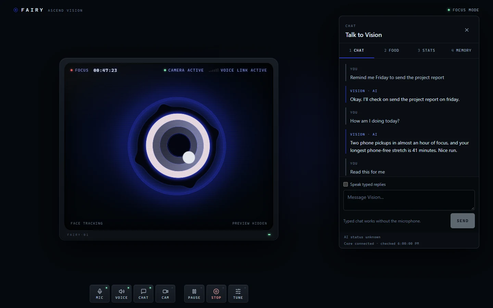
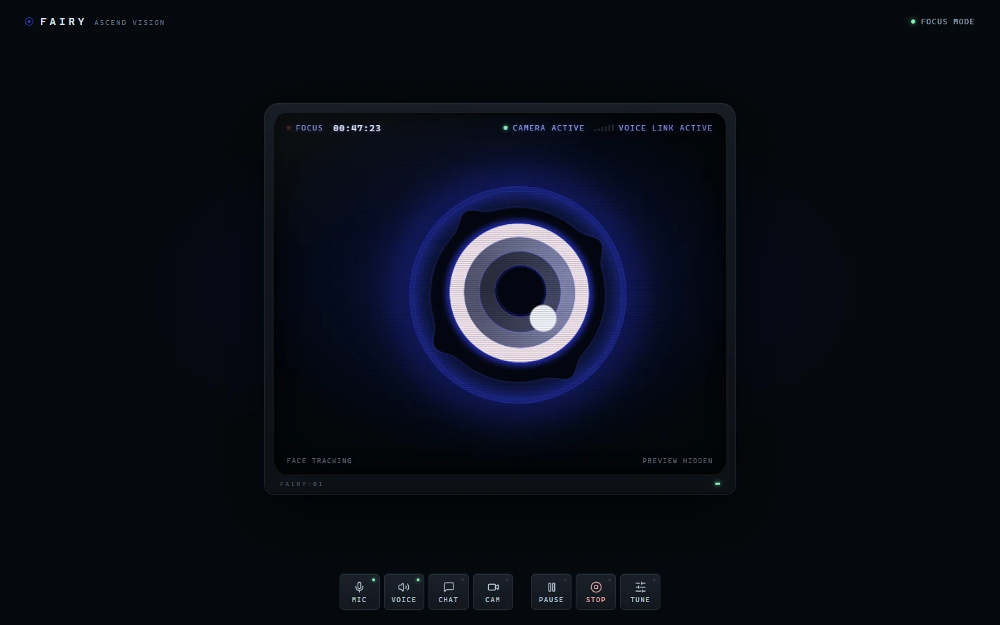
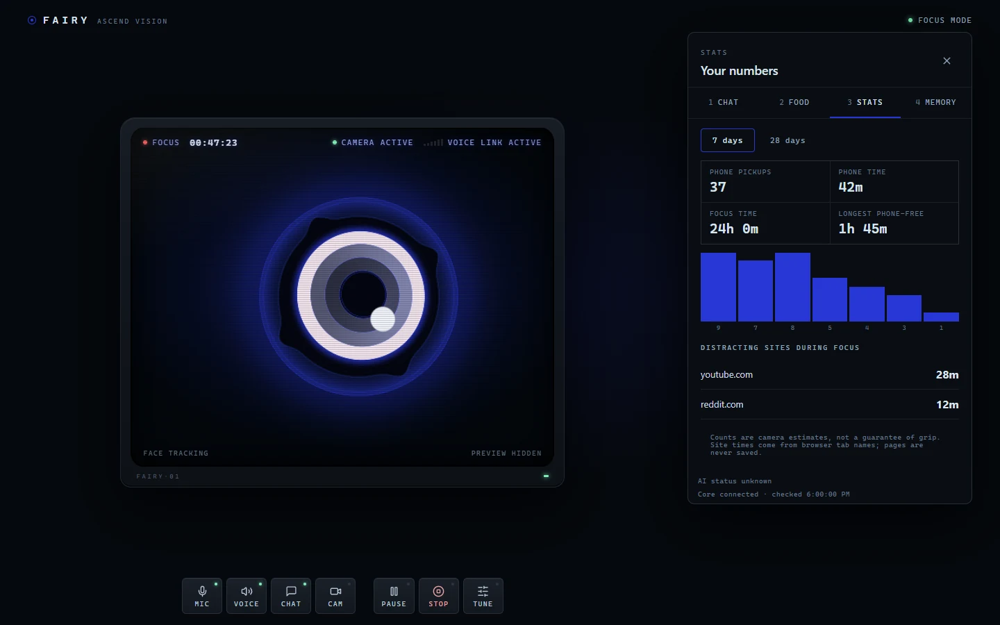
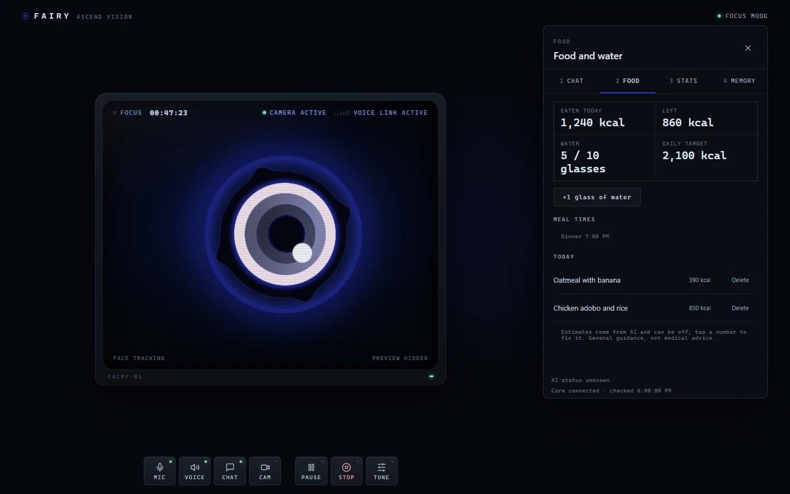
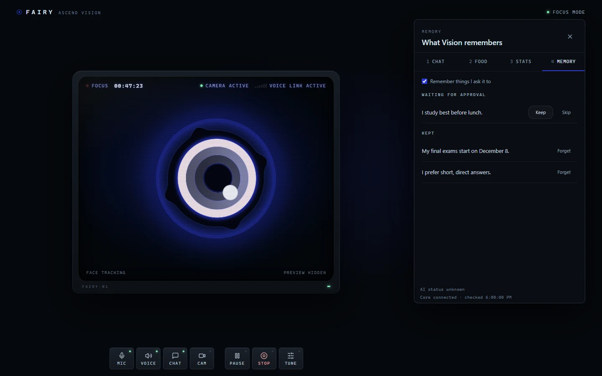
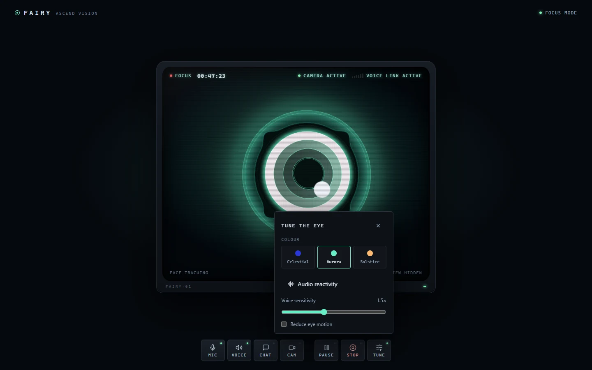

<div align="center">


# Ascend Vision

**A desktop companion that watches for your phone, keeps you focused, and talks with you.**

Vision uses your webcam to notice when you pick up your phone and reacts through an animated eye. You can talk to it by voice or text to set reminders, get coached on your habits, and have documents read for you. Detection runs entirely on your computer.




</div>

## Contents

- [What it is](#what-it-is)
- [Features](#features)
- [Screenshots](#screenshots)
- [Requirements](#requirements)
- [Quick start](#quick-start)
- [How it works](#how-it-works)
- [Project layout](#project-layout)
- [Configuration](#configuration)
- [Development](#development)
- [Privacy](#privacy)
- [License and credits](#license-and-credits)

## What it is

Ascend Vision started as a phone-pickup detector and grew into a voice assistant for the desk. It is one of three projects in the Ascend ecosystem, and it also runs on its own:

| Project | Role |
| --- | --- |
| **Ascend Vision** (this repo) | The desktop companion: camera, voice, chat and coaching. |
| [Ascend Core](https://github.com/RIll-cmd/ascend-core) | A gamified self-mastery platform. It can receive Vision's focus and discipline events. |
| [Ascend Hub](https://github.com/RIll-cmd/ascend-hub) | A dashboard for AI coding agents. Vision can read its questions aloud and take spoken answers. |

## Features

### Attention

- **Phone pickup detection** with YOLO object detection and MediaPipe hand landmarks. A pickup only counts after a hold-confirmation state machine agrees, which cuts false alarms.
- **Posture, drowsiness, yawn and expression tracking** from MediaPipe face and body landmarks.
- **Hand gestures** for controlling Vision without touching the keyboard.
- **Stats**: pickups, phone time, focus time and your longest phone-free stretch, over 7 or 28 days, in a local SQLite database.
- **Assistant mode**: voice, chat and notices without the camera, using about 620 MB of memory instead of 1.1 GB.

### Companion

- **The Fairy eye**: a procedural WebGL eye with an SVG fallback. It follows your face, reacts to your voice and shows when it is listening, thinking or asleep.
- **Voice and chat**: local speech recognition with faster-whisper, offline speech output, and replies from Gemini with Groq and Cerebras as fallbacks. It still answers simply with no key at all.
- **Approved memory**: Vision proposes what to remember and keeps nothing until you press Keep.
- **Phone and Discord**: optional phone chat and a Discord bot, so you can reach Vision away from the desk.

### Coaching

- **Commitment chaser**: "remind me Friday to send the report" or "I'll fix the login tomorrow". When it is due, Vision looks for a matching commit before asking, then checks in more firmly over the following days.
- **Focus blocks**: "do not disturb for 25 minutes" holds Vision's notices and phone pushes, and summarizes what waited when the block ends.
- **Slump detector**: compares your last three days with your own usual and offers one small step when things slip.
- **Food and water**: log meals by saying what you ate, and get gentle water reminders.
- **Weather and GitHub check-ins**: short, paced notices for your places and your contribution streak.

### Tools

- **Show me once**: say "watch me", do a task while talking it through, and get a step-by-step guide with screenshots, a screen video with your narration, and a transcript.
- **Read this for me**: your screen, a page held up to the camera, or a PDF. You hear a plain summary and the red flags ranked by severity. A first look, not legal advice.
- **License check**: lists the packages an agent session added and flags risky licenses.
- **Release notes**: turns commits into a changelog, a "what's new" list and a short post in your own voice.
- **Dormant work revival**: once a week, brings back one unmerged branch, stale worktree, stopped session or old issue.
- **Prompt coach**: grades your prompts to AI agents by how much rework they caused, and coaches you in three lines.
- **Browser automation** (optional): research and page tasks in a separate browser that asks before anything changes.

## Screenshots

These show the real interface with sample data.

<table>
  <tr>
    <td width="50%"><br /><b>Focus mode.</b> The eye follows your face.</td>
    <td width="50%"><br /><b>Stats.</b> Your habits over 7 or 28 days.</td>
  </tr>
  <tr>
    <td width="50%"><br /><b>Food and water.</b> Logged by voice or text.</td>
    <td width="50%"><br /><b>Memory.</b> Nothing is kept until you approve it.</td>
  </tr>
</table>



## Requirements

- Windows 10 or 11
- [Python 3.11](https://www.python.org/downloads/release/python-3119/) (tick "Add python.exe to PATH")
- [Node.js LTS](https://nodejs.org)
- A webcam for detection, and a microphone for voice. Both are optional in assistant mode.
- A free [Gemini API key](https://aistudio.google.com/apikey) for AI replies. Optional; without one, Vision gives simple replies.

## Quick start

```powershell
git clone https://github.com/RIll-cmd/ascend-vision.git
cd ascend-vision\ascend-vision
```

1. Double-click **`Setup.bat`**. It creates the Python environment, installs everything, downloads the models and asks for your AI key.
2. Double-click **`Start Vision.bat`**. Your browser opens the Vision window.
3. Allow the camera if asked. Vision starts in focus mode.

Click **Chat** to type to it, or just talk. The [user guide](ascend-vision/README.md) covers every setting and voice command.

## How it works

```text
Webcam ──> capture ──> YOLO + MediaPipe ──> state machine ──> SQLite
                                                  │
Microphone ──> faster-whisper ──> local commands  │
                                  and coaches     ▼
                                       │     notice pacer ──> speech and the Fairy eye
                                       ▼
                                   AI provider (short text only)
```

- **Python owns the hardware.** One process runs the camera, the microphone and the models, and serves the interface on a loopback-only port.
- **Coaches share one voice.** Every unprompted notice goes through a single pacer, so Vision never talks over itself and a focus block can hold them all.
- **Local first.** Spoken commands are matched on your computer before anything reaches an AI provider.

## Project layout

```text
ascend-vision/
├── main.py                The runtime: camera loop, wiring and CLI
├── detector.py, hands.py  Phone and hand detection
├── state_machine.py       Hold confirmation for pickups
├── voice_listener.py      Microphone and faster-whisper
├── llm_router.py          AI providers with fallback
├── assistant/             Chat, memory and the coaches
├── integrations/          Ascend Core, Ascend Hub, phone chat and Discord
├── browser/               The optional browser automation broker
├── fairy-ui/              The interface: React, TypeScript and WebGL
├── templates/, static/    The optional habit dashboard
├── tests/                 Python test suite
└── config.yaml            Every setting, with defaults
```

## Configuration

Everything has a default, so you only edit [`config.yaml`](ascend-vision/config.yaml) to change something. Every feature can be turned off there. The [settings table](ascend-vision/README.md#settings-you-may-want) lists the common ones. Keys belong in `.env`; see [`.env.example`](ascend-vision/.env.example).

## Development

From `ascend-vision/`:

```powershell
# Python tests (no camera or microphone needed)
.venv\Scripts\python.exe -m pip install -r requirements-dev.txt
.venv\Scripts\python.exe -m pytest

# Interface tests
cd fairy-ui
npm install
npx playwright install chromium
npm test
```

## Privacy

- **No video or images are saved or uploaded** by detection. Only derived data, such as when a pickup happened and how long it lasted, is stored, in local SQLite.
- **AI providers receive short text only**: what you say or type to the assistant, and derived counts. Nothing goes to one unless you add a key.
- **"Read this for me" sends the one image or PDF you ask about to Gemini**, and only when you ask. "Show me once" sends only your words, unless you turn that off.
- **The interface listens only on `127.0.0.1`.**

Pickup counts are camera estimates, not proof that you were holding a phone.

## License and credits

Ascend Vision's own code is released under the [MIT License](LICENSE).

It builds on open source projects that keep their own licenses, including [Ultralytics YOLO](https://github.com/ultralytics/ultralytics) (AGPL-3.0), [MediaPipe](https://github.com/google-ai-edge/mediapipe) (Apache-2.0), [faster-whisper](https://github.com/SYSTRAN/faster-whisper) (MIT), [Kokoro ONNX](https://github.com/thewh1teagle/kokoro-onnx) (MIT) and [OGL](https://github.com/oframe/ogl) (Unlicense). If you redistribute Vision bundled with Ultralytics YOLO, its AGPL-3.0 terms apply to that bundle.
